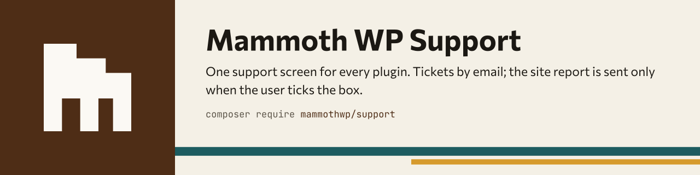
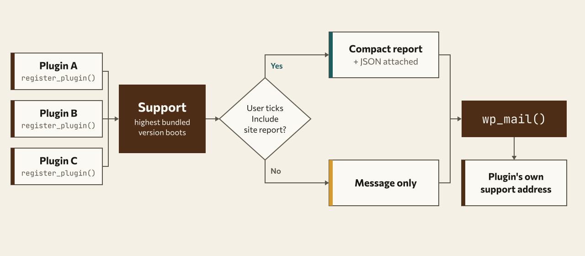

<h1 align="center">
<picture>
  <source media="(prefers-color-scheme: dark)" srcset="docs/assets/banner-dark.svg">
  
</picture>
</h1>

One shared **Support** screen for every plugin that bundles this package. The customer fills in a form in wp-admin, the site sends **one email** with `wp_mail()`: their message, plus a compact site report **only if they tick a box** (unticked by default, with an exact preview).

GPL-2.0-or-later. Free for any plugin developer. It ships inside Mammoth WP plugins (wordpress.org and premium) and is written to pass the wordpress.org review.

## How it works

<picture>
  <source media="(prefers-color-scheme: dark)" srcset="docs/assets/diagram-dark.svg">
  
</picture>

## Quick start

```bash
composer require mammothwp/support
```

In your main plugin file (the Composer autoloader must already be loaded):

```php
\MammothWP\Support\Support::register_plugin( __FILE__, [
    'email' => 'support@example.com', // required: where tickets for THIS plugin go
] );
```

That is the whole integration. Name, version, vendor and slug come from the plugin header and folder name. Without a valid `email` the plugin is listed but its Send button is disabled and `_doing_it_wrong()` is raised; there is never a fallback address.

No-PHP alternative: put `mammothwp-support.json` in the plugin root and call `register_plugin( __FILE__ )`.

```json
{
    "email": "support@example.com",
    "docs_url": "https://example.com/docs"
}
```

Array keys override the JSON file. All keys: [docs/CONFIGURATION.md](docs/CONFIGURATION.md).

## Install / integrate

Plugins require the package from Packagist at default stability (`mammothwp/wp-kit` `^2.0` arrives transitively); no `@dev` flag or `minimum-stability` override is needed.

```json
{
    "require": { "mammothwp/support": "^1.1" }
}
```

## Privacy statement

Nothing leaves the site without an explicit user action (wordpress.org guideline 7). The package has no tracking, no phoning home, no remote assets, no update checks and no automatic sends. The only outgoing data is the one email a logged-in administrator sends by pressing **Send**. The site report is added only when they tick **Include site report**, and **Preview what will be sent** shows the exact text. Secrets are never collected and a redaction pass runs over everything. Copy-paste text for your `readme.txt`: [docs/PRIVACY.md](docs/PRIVACY.md).

## Where the screen lives

One canonical screen; plugins can only add shortcuts to it, never move it.

| Location | Meaning |
|---|---|
| `toplevel` | Own top-level menu (position filterable). Default **when a registered plugin has vendor "Mammoth WP"**, titled "Mammoth WP" with the submenu "Support". |
| `tools` | Tools → Support. Default otherwise (neutral title "Support", no new top-level menu). |
| `settings` | Settings → Support. |
| `parent:<menu-slug>` | Submenu of any existing menu. |
| `hidden` | Registered page without a menu item (shortcuts and links only). |

Site owners override with the constant `MMWP_SUPPORT_MENU` or the filter `mmwp_support_menu` (the filter wins). A plugin adds a shortcut under its own menu with `'menu' => [ 'parent' => 'my-plugin-settings', 'title' => 'Support' ]`; it links to the canonical screen with that plugin preselected. Every registered plugin also gets a "Support" action link on the Plugins screen (`mmwp_support_action_link` turns it off). `Support::MENU_PARENT` (`mmwp-support`) is the top-level menu slug, so Mammoth WP plugins can add pages under it. In multisite the screen is per site, plus a network admin screen when a registered plugin is network-activated.

`wp mmwp support plugins` and the report show the resolved location and where it came from.

## White-label

Branding (name, menu and page titles, icon, local logo, subject prefix, reference prefix, "Powered by", vendor names) resolves from defaults (Mammoth WP when a Mammoth WP plugin is registered, neutral otherwise), then a plugin's `'branding'` array (honoured only when every registered plugin has the same vendor), then the site owner's `MMWP_SUPPORT_WHITELABEL` constant (`true` = fully neutral, or an array of overrides), then the `mmwp_support_branding` filter. Agency guide: [docs/WHITELABEL.md](docs/WHITELABEL.md).

## Site-owner overrides

| Setting | Constant | Filter | Order |
|---|---|---|---|
| Recipient | `MMWP_SUPPORT_EMAIL_<SLUG_UPPER_UNDERSCORED>` | `mmwp_support_email` | filter > constant > array > JSON |
| Menu location | `MMWP_SUPPORT_MENU` | `mmwp_support_menu` | filter > constant > default |
| White-label | `MMWP_SUPPORT_WHITELABEL` | `mmwp_support_branding` | filter > constant > vendor > defaults |

## Adding a report section

```php
add_filter( 'mmwp_support_report_sections', function ( array $sections ): array {
    $sections[] = new My_Plugin_Report_Section(); // implements \MammothWP\Support\Report\Section_Interface
    return $sections;
} );
```

`Section_Interface` has `key()`, `label()` and `collect()` (scalars, lists or one level of associative arrays). Contract: **no secrets** (no keys, tokens, passwords, customer data). A redaction pass over the whole report removes absolute paths (ABSPATH), emails, IP addresses, URL credentials, `key=value` pairs with secret-looking keys, JWTs and long tokens, but do not rely on it.

## Reference

### Filters, actions, constants

| Name | Kind | Default / purpose |
|---|---|---|
| `mmwp_support_capability` | filter | `manage_options` (`manage_network_options` on the network screen) |
| `mmwp_support_email` | filter | Recipient per plugin; wins over everything |
| `mmwp_support_menu` | filter | `null` (no override); a location string |
| `mmwp_support_menu_position` | filter | `80` |
| `mmwp_support_branding` | filter | Resolved branding values |
| `mmwp_support_action_link` | filter | `true` |
| `mmwp_support_subject` | filter | `<prefix>[<slug>] <subject> (<ref>)` |
| `mmwp_support_rate_limit` | filter | `[ 'max' => 3, 'window' => 600 ]` per user |
| `mmwp_support_attach_report` | filter | `true` |
| `mmwp_support_report_sections` | filter | Core sections |
| `mmwp_support_transport` | filter | `MailTransport` |
| `mmwp_support_booted` | action | After the winning copy booted |
| `MMWP_SUPPORT_EMAIL_<SLUG>` | constant | Recipient override |
| `MMWP_SUPPORT_MENU` | constant | Location override |
| `MMWP_SUPPORT_WHITELABEL` | constant | `true` or array |

Signatures: [HOOKS.md](HOOKS.md). Defaults live in one class, `MammothWP\Support\Config`.

### REST, WP-CLI, Abilities

One definition (via `mammothwp/wp-kit`), three surfaces, all calling the same services as the admin screen. Capability `manage_options` (filterable).

| Operation | REST (`mmwp/v1`) | WP-CLI | Ability |
|---|---|---|---|
| report (`format`: `text`\|`json`) | `GET /support/report` | `wp mmwp support report [--format=<text\|json>]` | `mmwp/support-report` |
| plugins | `GET /support/plugins` | `wp mmwp support plugins` | `mmwp/support-plugins` |
| send (`plugin`, `subject`, `message`, `reply_to`, `name`, `include_report`, `include_log`, `dry_run`) | `POST /support/send` | `wp mmwp support send --plugin=<slug> --message=<text> [--include-report] [--dry-run]`* | `mmwp/support-send` (needs `confirm: true`) |

\* CLI flags are the dashed field names (`--reply-to`, `--include-report`, `--include-log`, `--dry-run`). A dry run prints the email (recipient, subject, headers, body, attachment name) and sends nothing. `include_report` and `include_log` default to false everywhere.

If another plugin loaded an older (or no) wp-kit first, REST/CLI/Abilities are skipped, a dismissible notice appears on the Support screen only, and the screen keeps working through `admin-post.php`.

## Single instance across many plugins

Every bundled copy registers its version and path in a shared registry. On `plugins_loaded` (priority -50) exactly one copy boots: the highest version. It prepends a class loader for `MammothWP\Support\` pointing at its own `src/`, so its classes are the ones used. Only `Support` (a thin shim) and the functions in `bootstrap.php` come from whichever copy loaded first, so they stay tiny and backwards compatible forever. `register_plugin()` may be called before boot (queued, replayed) or after (applied at once). The menu appears only if at least one plugin is registered.

### Bundling

wp-kit has no election across plugins: whichever copy loads first wins. Prefix bundled libraries (for example with [Strauss](https://github.com/BrianHenryIE/strauss)) so your copies cannot collide with another plugin's. This package guards against it (it checks the loaded wp-kit version) but cannot fix it.

## Transport

`TransportInterface` with one implementation, `MailTransport` (`wp_mail()`); swap through `mmwp_support_transport`. There is no API transport. Any future one needs the same explicit user consent.

## Development

```bash
composer install
composer lint && composer test && composer phpcs && composer phpstan
```

CI runs phpcs, phpstan, phpunit.

## Branches

`develop` is the working branch. `main` is release-only.

## Brand

Naming, prefixes and tone: [docs/BRAND.md](docs/BRAND.md).
